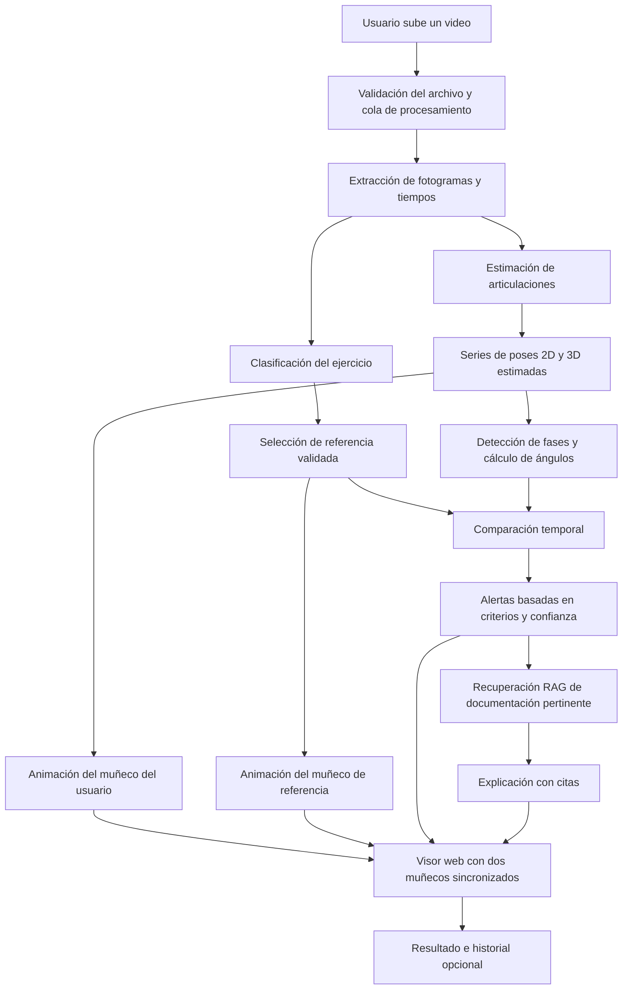
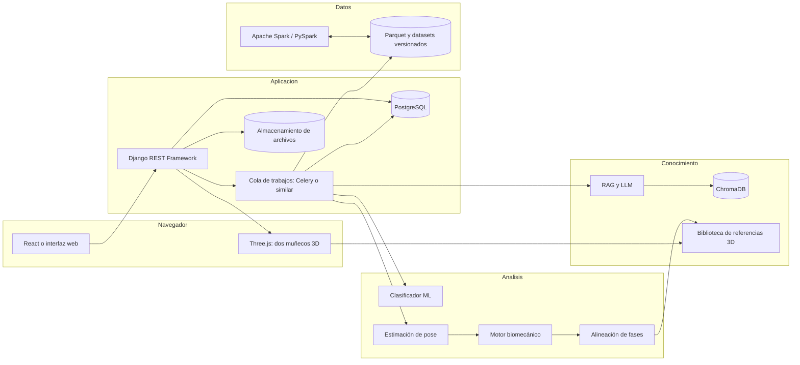
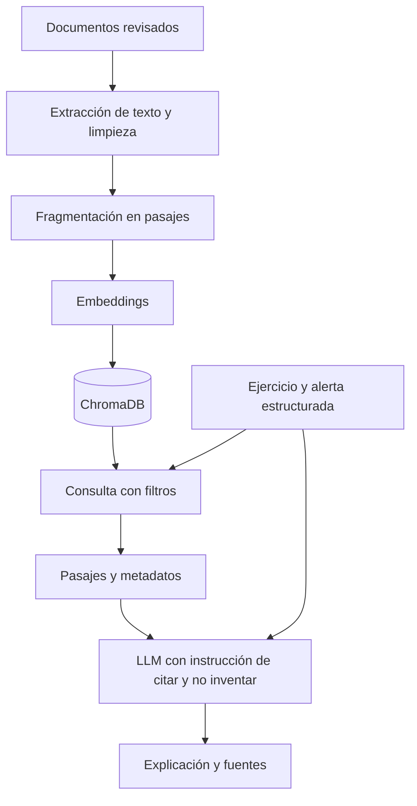

# VISION3D AI

## Plataforma inteligente de análisis de ejercicios, comparación de posturas 3D y explicaciones con RAG y Big Data

**Documento de definición funcional y técnica — versión 1.0**  
**Fecha:** 12 de octubre de 2026  
**Equipo propuesto:** Richard Rocuant y Luis Huanel  
**Estado:** Diseño de proyecto; no constituye evidencia de que la aplicación esté desarrollada.

---

## Índice

1. [Resumen ejecutivo](#1-resumen-ejecutivo)
2. [Origen del proyecto y relación con el informe de Machine Learning](#2-origen-del-proyecto-y-relación-con-el-informe-de-machine-learning)
3. [Problema, propuesta de valor y usuarios](#3-problema-propuesta-de-valor-y-usuarios)
4. [Funcionamiento de la aplicación](#4-funcionamiento-de-la-aplicación)
5. [Los dos muñecos anatómicos 3D](#5-los-dos-muñecos-anatómicos-3d)
6. [Tres modos de entrada: imagen, video y cámara](#6-tres-modos-de-entrada-imagen-video-y-cámara)
7. [Arquitectura general](#7-arquitectura-general)
8. [Módulo de Machine Learning y visión artificial](#8-módulo-de-machine-learning-y-visión-artificial)
9. [Motor de análisis biomecánico y alertas rojas](#9-motor-de-análisis-biomecánico-y-alertas-rojas)
10. [Módulo 3D: Blender y Three.js](#10-módulo-3d-blender-y-threejs)
11. [Módulo RAG y asistente de IA](#11-módulo-rag-y-asistente-de-ia)
12. [Big Data con Apache Spark](#12-big-data-con-apache-spark)
13. [Tecnologías y responsabilidades](#13-tecnologías-y-responsabilidades)
14. [Diseño del backend, API y datos](#14-diseño-del-backend-api-y-datos)
15. [Interfaz de usuario](#15-interfaz-de-usuario)
16. [Ejemplo completo de uso](#16-ejemplo-completo-de-uso)
17. [Plan de implementación y MVP](#17-plan-de-implementación-y-mvp)
18. [Validación y métricas](#18-validación-y-métricas)
19. [Seguridad, privacidad y límites](#19-seguridad-privacidad-y-límites)
20. [Riesgos y decisiones pendientes](#20-riesgos-y-decisiones-pendientes)
21. [Organización del trabajo de la dupla](#21-organización-del-trabajo-de-la-dupla)
22. [Criterios de aceptación y próximos pasos](#22-criterios-de-aceptación-y-próximos-pasos)
23. [Glosario](#23-glosario)
24. [Referencias técnicas y fuentes](#24-referencias-técnicas-y-fuentes)

---

## 1. Resumen ejecutivo

**VISION3D AI** será una aplicación web educativa de análisis de ejercicios físicos. Permitirá cargar **fotografías y videos** y, en una versión posterior, utilizar una **cámara en directo**. Su objetivo es reconocer el ejercicio, estimar las posiciones corporales, reproducirlas mediante un **muñeco anatómico 3D** y compararlas con un **segundo muñeco 3D que muestra una ejecución de referencia**.

### Resultado central

La pantalla de análisis mostrará **dos modelos anatómicos tridimensionales uno al lado del otro**:

- **Izquierda — movimiento del usuario:** representación estimada a partir de la imagen o el video. Las articulaciones o regiones con posibles desviaciones aparecerán **en rojo**, acompañadas de una explicación.
- **Derecha — movimiento de referencia:** animación o postura revisada previamente, vinculada al ejercicio y a la fase correspondiente. Su función será facilitar la comparación, no afirmar que existe una única postura correcta para todas las personas.

El usuario podrá rotar los personajes, acercarse, pausar un video, avanzar fotograma a fotograma, observar las fases de un ejercicio y consultar explicaciones respaldadas por documentación mediante **RAG** (*Retrieval-Augmented Generation*).

**Apache Spark** se empleará para preparar, transformar y analizar conjuntos grandes de imágenes, metadatos y series temporales de articulaciones, además de realizar ensayos medibles de escalabilidad. No será el componente que dibuja los personajes ni el que responde en tiempo real a la cámara.

> **Precisión técnica:** este proyecto no pretende generar un humano 3D nuevo desde cero para cada archivo. Propone usar uno o varios muñecos 3D **precreados y articulados**, y generar sus **poses y animaciones** a partir de los datos detectados. Es animación/reconstrucción estimada 3D basada en visión artificial, con posibilidad de añadir IA generativa 3D como mejora posterior.

### Objetivo general

Diseñar e implementar una plataforma web que integre **Machine Learning, visión artificial, comparación de movimientos anatómicos 3D, recuperación de conocimiento mediante RAG y procesamiento de datos con Apache Spark**, para ofrecer análisis visuales y explicativos de ejercicios físicos.

### Objetivos específicos

1. Entrenar y evaluar un clasificador de los ejercicios disponibles en el dataset preparado por la dupla.
2. Detectar puntos corporales en imágenes y seguir su movimiento en videos.
3. Reconstruir poses 3D aproximadas sobre un personaje anatómico reutilizable.
4. Mostrar dos personajes sincronizados: usuario y referencia.
5. Detectar desviaciones **medibles y validadas**; resaltarlas en rojo sin inventar diagnósticos.
6. Recuperar documentos técnicos mediante RAG y citar las fuentes de las explicaciones.
7. Crear un pipeline con PySpark que transforme y analice conjuntos de datos a diferentes escalas.
8. Desarrollar una aplicación web segura, verificable y extensible.

---

## 2. Origen del proyecto y relación con el informe de Machine Learning

El punto de partida es el trabajo de Richard Rocuant y Luis Huanel titulado **«Preparación de imágenes de ejercicios físicos: Recolección y preparación de datos para Machine Learning»**, también identificado como **«Ev2_Richard_Luis_codigo_en_bloques.docx»**.

### 2.1. Qué tienen realmente avanzado

Según el informe consultado, la evaluación preparó un dataset público para **futura clasificación supervisada**, pero **todavía no entrenó un clasificador ni reportó métricas como accuracy**. Esta diferencia es importante para no confundir la fase de preparación con la de entrenamiento.

| Elemento documentado | Resultado del informe |
|---|---|
| Fuente | Kaggle, *Exercise Images With Pose Estimation* de `asher213` |
| Archivo original | `imagePoses.csv` |
| Registros iniciales | **3.501** |
| Registros separados por etiquetas contradictorias | **141** |
| Duplicados exactos adicionales retirados | **39** |
| Imágenes depuradas finales | **3.321** |
| Categorías conservadas | **9** |
| Particiones de validación | **5 folds** |
| Aumento registrado | **2.656 variantes** del entrenamiento del primer fold |
| Clasificador entrenado | **No, todavía pendiente** |
| Evaluación real de accuracy, F1 y matriz de confusión | **Pendiente** |

Las cantidades se refieren al procesamiento documentado de esa versión concreta del CSV. No deben cambiarse ni reinterpretarse como resultados del nuevo proyecto sin volver a ejecutar el proceso y registrar su procedencia.

### 2.2. Las nueve categorías del dataset preparado

| Etiqueta de origen | Nombre descriptivo |
|---|---|
| `Bent-over row` | Remo inclinado |
| `Chest dips` | Fondos de pecho |
| `Glute bridge` | Puente de glúteos |
| `Lunges` | Zancadas |
| `Plank` | Plancha |
| `Pull-up` | Dominadas |
| `Push-up` | Flexiones de brazos |
| `Shoulder press` | Press de hombros |
| `Squat` | Sentadillas |

**Primera implementación recomendada:** comenzar con **sentadillas** para la comparación 3D y las alertas. El sistema de clasificación podrá ampliarse gradualmente a los nueve ejercicios, sin asumir que ya existe una biblioteca de técnicas y errores validada para todos.

### 2.3. Estructura del CSV de partida

El informe señala estas seis columnas de origen:

```text
imageName
base64encoded
imageWidth
imageHeight
poseLandmarks
excercise
```

El nombre **`excercise`** mantiene el error ortográfico presente en el archivo de origen; no debe corregirse arbitrariamente en la lectura sin conservar trazabilidad. En la tabla preparada se añade una etiqueta normalizada (`label`) y metadatos de control como `image_hash` y `validation_fold`.

### 2.4. Qué se reutilizará y qué falta

**Se reutiliza:**

- Procedimiento de descarga, carga, inspección y auditoría del CSV.
- Normalización de las clases y separación de registros conflictivos.
- Deduplicación por contenido y cálculo de SHA256.
- Diseño de cinco folds de validación sin coincidencias exactas de imágenes entre entrenamiento y validación.
- Aumento de imágenes **únicamente en entrenamiento**.
- Scripts, cuaderno y bitácora reproducible.

**Debe desarrollarse:**

- Entrenamiento y evaluación del clasificador.
- Pruebas sobre imágenes y personas externas al dataset.
- Extracción consistente de articulaciones en videos nuevos.
- Biblioteca de secuencias de referencia y criterios biomecánicos revisados.
- Retargeting al muñeco 3D y sincronización entre personajes.
- RAG, API, interfaz web y pipeline PySpark.

**Advertencia sobre evaluación:** los cinco folds controlan duplicados exactos, pero el informe indica que no cuenta con identificadores fiables de persona, sesión o secuencia. Por ello, esos folds **no prueban por sí solos generalización a personas nuevas**. Si se consiguen identificadores de persona o video, convendrá usar particiones por grupos.

### 2.5. Diferencia entre las dos tareas de aprendizaje

Hay **dos problemas de ML distintos**:

1. **Clasificación del ejercicio:** decidir si una imagen representa, por ejemplo, sentadilla o flexión. El informe prepara datos para esta tarea.
2. **Evaluación de técnica/postura:** determinar si hay una desviación respecto a un criterio específico. **No se puede entrenar fiablemente este segundo modelo con las etiquetas del CSV original si solo nombran ejercicios**. Hará falta un nuevo conjunto de ejemplos **etiquetados por tipo de error**, idealmente revisados por especialistas.

La pose extraída por MediaPipe puede ayudar a calcular ángulos, pero **no demuestra por sí sola** que un ejercicio esté bien o mal ejecutado.

---

## 3. Problema, propuesta de valor y usuarios

### 3.1. Problema

Una persona puede grabarse haciendo ejercicio, pero le resulta difícil comparar de forma objetiva sus movimientos con una demostración de referencia. Una fotografía no muestra la evolución temporal y un video ordinario no calcula automáticamente articulaciones ni ofrece una explicación apoyada en documentación.

### 3.2. Propuesta de valor

Unir en una sola experiencia:

- **Reconocimiento** del ejercicio.
- **Estimación** del cuerpo y del movimiento.
- **Comparación** de dos muñecos anatómicos en 3D.
- **Señalización** de las regiones que requieren revisión.
- **Explicación** de cada alerta con fuentes recuperadas por RAG.
- **Historial** consultable de análisis autorizados por el usuario.

### 3.3. Público inicial

Proyecto académico, estudiantes de informática, docentes y usuarios que desean explorar el análisis visual de técnica deportiva. En esta etapa es un **asistente educativo**, no un dispositivo médico ni un sustituto de un entrenador o profesional sanitario.

---

## 4. Funcionamiento de la aplicación

### 4.1. Flujo principal de un video



### 4.2. Flujo de una imagen

1. Se valida y carga la fotografía.
2. Se identifica el ejercicio, o se solicita confirmación al usuario cuando la confianza es insuficiente.
3. Se detectan articulaciones visibles y se estima una pose 3D **aproximada**.
4. Se selecciona una postura de referencia para una fase comparable, **cuando pueda determinarse**.
5. Se muestran los dos muñecos y solo aquellas alertas sustentadas por medidas visibles y criterios validados.
6. Se ofrece una explicación documental por RAG.

**Limitación:** una sola fotografía puede ocultar profundidad, articulaciones y fases anteriores/posteriores del movimiento. El sistema deberá indicar **«análisis limitado por imagen estática»** y abstenerse de evaluar parámetros temporales como velocidad, estabilidad a lo largo del tiempo o número de repeticiones.

### 4.3. Flujo de cámara en vivo — fase futura

La cámara enviará secuencias al estimador de postura; el muñeco del usuario se actualizará con baja latencia y se comparará con la referencia de la fase actual. Para evitar información engañosa, las alertas deberán usar filtrado temporal, confianza mínima, estabilidad en varios fotogramas y mecanismos para no mostrar avisos cuando falten articulaciones.

**La cámara en vivo no es requisito del primer MVP**; requiere controles adicionales de rendimiento y privacidad.

---

## 5. Los dos muñecos anatómicos 3D

### 5.1. Muñeco A: usuario (izquierda)

- Representa una versión anatómica estándar, no una copia fotorrealista del usuario.
- Las poses se calculan desde puntos corporales detectados en cada fotograma.
- Reproduce el movimiento en la línea de tiempo del video.
- Las articulaciones o segmentos sospechosos se marcan **en rojo**.
- Se pueden destacar rodillas, cadera, hombros, espalda o codos **siempre que los datos y la regla correspondiente lo permitan**.
- Si la medición es poco fiable, se usa **gris / «no evaluable»**, en lugar de un rojo injustificado.

### 5.2. Muñeco B: referencia (derecha)

- Usa el mismo rig o esqueleto base que el muñeco del usuario.
- Reproduce una animación de referencia **almacenada y validada** para el ejercicio.
- Debe poder sincronizarse por **fase de movimiento** (por ejemplo, inicio, bajada, posición inferior y subida), no solo por el mismo segundo del video.
- Puede ofrecer más de una referencia cuando existan variantes técnicas legítimas del ejercicio.
- Permite ver el movimiento desde los mismos ángulos que el muñeco A.

### 5.3. Convención de colores

| Color | Significado propuesto |
|---|---|
| **Rojo** | Posible desviación detectada que necesita revisión |
| **Verde** | Coincidencia con el criterio de referencia disponible |
| **Amarillo** | Resultado limítrofe o advertencia de incertidumbre |
| **Gris** | Zona no observable o no evaluable |

Los colores representan **resultados del algoritmo**, no diagnósticos médicos ni certeza biomecánica absoluta.

### 5.4. ¿Se genera el muñeco en vivo o está guardado?

**Arquitectura elegida: híbrida.**

- **Guardado:** malla anatómica, huesos (`rig`), materiales y animaciones de referencia.
- **Calculado al subir una imagen:** conjunto de articulaciones y pose estimada para ese instante.
- **Calculado al subir un video:** secuencia de articulaciones, fases, alertas y animación del muñeco del usuario.
- **Calculado en vivo:** actualización de las poses conforme llegan fotogramas, cuando se implemente la cámara.

Por tanto, lo nuevo no es necesariamente el modelo 3D completo, sino **la animación y los resultados del análisis**.

---

## 6. Tres modos de entrada: imagen, video y cámara

| Característica | Imagen | Video | Cámara en vivo |
|---|---|---|---|
| Clasificar ejercicio | Sí | Sí | Sí |
| Detectar puntos articulares | Sí | Sí | Sí |
| Estimar pose 3D | Una pose | Serie de poses | Serie continua |
| Muñeco anatómico | Estático | Animado | Animado |
| Comparar con referencia | Limitado | Sí, por fase | Sí, por fase |
| Marcar posibles errores | Solo observables | Por segmentos y tiempos | Si hay confianza suficiente |
| Contar repeticiones | No | Potencialmente | Potencialmente |
| Almacenamiento | Opcional | Opcional | Evitable por defecto |
| Prioridad | MVP o segunda entrega | **MVP principal** | Fase avanzada |

### Decisión práctica

El primer producto debería centrarse en **subida de un video corto de sentadilla**, porque permite evaluar fases y movimientos que una imagen aislada no revela. Las fotos se incorporarían con un conjunto de alertas más limitado.

---

## 7. Arquitectura general



### Responsabilidades y separación de cargas

**Camino interactivo:** validación de archivo → clasificación → articulaciones → comparación → respuesta para el visor.  
**Camino documental:** resultado del análisis → recuperación de documentos → explicación con citas.  
**Camino Big Data (por lotes):** ingesta de conjuntos de datos → transformación/estadística con Spark → Parquet → investigación y reentrenamiento.

La separación evita enviar cada fotograma de una cámara en vivo a Spark o a un LLM, lo cual sería una elección arquitectónica innecesaria y costosa.

---

## 8. Módulo de Machine Learning y visión artificial

### 8.1. Clasificación de ejercicios

**Entrada:** imagen o fotogramas de video.  
**Salida:** etiqueta del ejercicio, probabilidades o puntajes del modelo y estado de confianza.

**Ruta propuesta:**

1. Reutilizar `imagePoses.csv` depurado y las particiones documentadas.
2. Entrenar un **modelo base** de clasificación (por ejemplo, una CNN mediante transferencia de aprendizaje).
3. Crear alternativas de comparación (por ejemplo, clasificador de características extraídas de pose, cuando sea viable).
4. Evaluar por clase y con datos externos.
5. Exponer el modelo a través de un endpoint interno.

No hay evidencia, todavía, de que el clasificador reconozca las nueve clases en producción: eso debe medirse después del entrenamiento.

### 8.2. Estimación de postura

**Herramienta inicial:** MediaPipe Pose Landmarker. Puede operar con imagen, video y transmisión en vivo, y entrega puntos anatómicos estimados. Estos puntos son una **inferencia del modelo** y no equivalen a medidas clínicas de alta precisión.

**Ejemplo conceptual de registro para un fotograma:**

```json
{
  "timestamp_ms": 1240,
  "landmarks": {
    "left_hip": {"x": 0.45, "y": 0.57, "z_est": -0.10, "visibility": 0.97},
    "left_knee": {"x": 0.46, "y": 0.73, "z_est": -0.03, "visibility": 0.94},
    "left_ankle": {"x": 0.48, "y": 0.91, "z_est": 0.02, "visibility": 0.95}
  }
}
```

*Los valores son ficticios. No fijan las unidades ni el marco de referencia de una implementación real; el adaptador deberá documentar explícitamente cuál salida de MediaPipe se utiliza y sus coordenadas.*

### 8.3. Limpieza temporal en videos

El seguimiento puede saltar por oclusión o movimiento rápido. Se propone:

- Respetar la tasa de fotogramas y los timestamps.
- Descartar puntos con confianza insuficiente.
- Interpolar huecos cortos cuando esté justificado; **no inventar movimientos largos no observados**.
- Aplicar filtros temporales configurables para reducir vibración.
- Registrar porcentaje de fotogramas válidos.

### 8.4. Determinación de la fase del ejercicio

Para la sentadilla se puede reconocer, de manera aproximada:

1. Posición inicial.
2. Descenso.
3. Posición inferior.
4. Ascenso.
5. Retorno a la posición inicial.

La fase puede derivarse de series temporales de ángulos articulares, posiciones de cadera y cambios de velocidad, sujetas a validación con videos anotados.

### 8.5. Datos adicionales necesarios

El CSV del informe **no es suficiente por sí solo** para detectar errores de técnica ni entrenar un sistema robusto para videos. Se necesitan:

- Videos reales con consentimiento y distintas vistas/condiciones.
- Etiquetas de fase temporal por ejercicio.
- Anotaciones de posibles errores realizadas por revisores competentes.
- Identificadores de persona/sesión para separar correctamente entrenamiento y evaluación.
- Ejemplos de ejecuciones adecuadas y diversas variantes aceptadas.

---

## 9. Motor de análisis biomecánico y alertas rojas

### 9.1. Qué hace

Recibe **articulaciones y fases** y produce mediciones interpretables, por ejemplo: ángulo aproximado de rodilla, inclinación estimada del torso, posición relativa de cadera, estabilidad de la postura a lo largo de una secuencia y consistencia entre repeticiones.

El motor **no debe usar el LLM como detector primario de errores**. Las alertas proceden de mediciones, reglas documentadas o modelos específicos evaluados; RAG ayuda a explicarlas después.

### 9.2. Cálculo básico de ángulo

Con tres puntos articulares A, B y C, el ángulo en B puede estimarse mediante:

\[
\theta = \arccos\left(\frac{(A-B)\cdot(C-B)}{\lVert A-B\rVert\;\lVert C-B\rVert}\right)
\]

Por ejemplo, para estudiar un ángulo de rodilla se usarían los puntos de cadera, rodilla y tobillo. Antes de calcular se deben verificar confianza, convención de coordenadas y posibles degeneraciones matemáticas.

### 9.3. Ejemplo hipotético — sentadilla

**Nunca usar estos avisos como verdades automáticas sin validación.** Una posible salida, una vez revisadas las reglas, podría ser:

| Región | Señal detectada | Visualización | Condición necesaria |
|---|---|---|---|
| Rodilla | Desviación de alineación en una fase | Rojo | Vista y articulaciones suficientes; referencia validada |
| Tronco | Inclinación fuera del rango de referencia seleccionado | Rojo o amarillo | Criterio contextual y certeza de estimación |
| Cadera | Medición dentro del rango de referencia | Verde | Datos válidos |
| Tobillo oculto | No evaluable | Gris | Punto no visible o baja confianza |

### 9.4. Reglas y umbrales

No se incluyen aquí **umbrales universales en grados** porque dependen del ejercicio, de su variante, de la anatomía de la persona, de la cámara y de criterios biomecánicos que aún no se han definido. Las reglas deben ser configurables y versionadas.

```text
REGLA (pseudocódigo):
si articulaciones_suficientes
   y confianza >= umbral_validado
   y fase == fase_objetivo
   y desviacion_supera_criterio_validado
   durante una ventana estable:
       alertar(zona, severidad, evidencia, regla_version)
si no:
       mostrar "no evaluable" o no generar alerta
```

### 9.5. Sincronización de dos movimientos

Dos personas pueden realizar una repetición a velocidades diferentes. Si se comparan exclusivamente por segundo, el sistema puede enfrentar una fase de bajada con una de subida y producir errores falsos.

**Propuesta:** alinear por fases o por un porcentaje de progreso de la repetición; en una versión avanzada se puede investigar **Dynamic Time Warping (DTW)** u otros métodos de alineación temporal.

El usuario podrá seleccionar una repetición, avanzar hasta el 50 % del descenso y ver los dos muñecos situados en la **fase equivalente**.

### 9.6. Interpretabilidad

Cada alerta debería guardar como mínimo: `region`, `tipo`, `fase`, `instante`, `medicion`, `regla_id`, `confianza`, `version_regla` y `estado_de_evaluabilidad`. Esto permite auditar **por qué** una región se volvió roja.

---

## 10. Módulo 3D: Blender y Three.js

### 10.1. Muñeco anatómico reutilizable

En **Blender** se crea o adapta un muñeco 3D estándar con:

- Malla anatómica legible.
- Esqueleto interno de huesos (*armature/rig*).
- Jerarquía de articulaciones que admita las poses estimadas.
- Materiales por región corporal para mostrar rojo, verde, amarillo o gris.
- Animaciones de referencia revisadas.

La compatibilidad de licencias deberá revisarse antes de reutilizar un modelo obtenido de terceros. Si se fabrica el modelo internamente, se documentará su autoría y licencia.

### 10.2. Exportación

Se propone exportar el muñeco con su rig y, cuando corresponda, animaciones a **GLB/glTF 2.0**. Blender documenta la exportación glTF y Three.js dispone de `GLTFLoader` y sistema de animación.

### 10.3. Retargeting

El estimador de pose devuelve puntos; el personaje usa huesos y rotaciones. Se necesita una capa de **retargeting** que:

1. Relacione puntos detectados con huesos del rig.
2. Normalice orientación y escala.
3. Calcule rotaciones válidas de huesos.
4. Evite deformaciones imposibles y temblores.
5. Mantenga el muñeco dentro de límites anatómicos razonables.

**Riesgo técnico principal:** un conjunto de landmarks no equivale automáticamente a una animación de alta calidad; el retargeting es un módulo independiente.

### 10.4. Interacción en la web

Three.js permitirá:

- Cargar dos instancias del muñeco.
- Aplicar animaciones calculadas y clips de referencia.
- Rotar y acercar cámaras.
- Mantener la misma cámara en ambos paneles.
- Resaltar articulaciones con alertas.
- Actualizar la línea de tiempo y cambiar la velocidad de reproducción.

### 10.5. Fotografía frente a video

- **Foto:** una pose estimada y estática.
- **Video:** curva temporal de posiciones/rotaciones de articulaciones.
- **En vivo:** actualización continua del rig a partir de fotogramas recientes.

No habrá recreación exacta de partes ocultas del cuerpo con una sola cámara; las partes no visibles se estimarán o declararán no evaluables.

---

## 11. Módulo RAG y asistente de IA

### 11.1. ¿Por qué RAG?

RAG combina la pregunta del usuario y los resultados calculados por el sistema con pasajes **recuperados de documentos confiables**. Permite fundamentar una explicación y mostrar referencias concretas.

**RAG no clasifica la imagen, no mide ángulos y no decide de forma primaria cuáles articulaciones están mal.** Sus tareas son recuperar contexto técnico y ayudar a redactar explicaciones comprensibles.

### 11.2. Base documental propuesta

- Guías de ejecución y biomecánica de ejercicios.
- Materiales educativos autorizados para uso en el proyecto.
- Referencias validadas por especialistas.
- Fichas de ejercicios y variantes.
- Definiciones de las reglas y su alcance.

Cada documento almacenará: título, autor/entidad, enlace, licencia, fecha, ejercicio aplicable, fecha de revisión y versión.

### 11.3. Pipeline RAG



**Ejemplo conceptual de entrada al RAG:**

```json
{
  "exercise": "Squat",
  "phase": "descent",
  "alert_code": "KNEE_ALIGNMENT_REVIEW",
  "measurement_source": "pose-estimation",
  "reference_version": "squat-v1",
  "language": "es"
}
```

**Respuesta ilustrativa:**

> «En esta fase se detectó una diferencia entre la alineación estimada de tu rodilla y el criterio de referencia usado. Puedes revisar la demostración lateral y frontal. La medición tiene incertidumbre por el ángulo de cámara. Consulta estas fuentes: …»

Si no existen documentos pertinentes, el asistente deberá decir que **no dispone de respaldo suficiente** y evitar producir recomendaciones definitivas.

### 11.4. Evaluación del RAG

- Relevancia de fragmentos recuperados (por ejemplo, `Recall@k`, `MRR`, `nDCG` cuando haya relevancias anotadas).
- Cobertura y corrección de las citas.
- Fidelidad de afirmaciones a las fuentes (*faithfulness*).
- Detección de afirmaciones no respaldadas.
- Capacidad de abstención cuando faltan fuentes.

### 11.5. Evolución posible

Se puede añadir conversación contextual: «¿por qué se marcó la rodilla en rojo?» o «muéstrame la parte del video donde ocurrió». La respuesta debe enlazar el momento exacto y la regla concreta, no responder de forma genérica.

---

## 12. Big Data con Apache Spark

### 12.1. Función real en la solución

El objetivo de Big Data es dar al proyecto una **línea de ingeniería de datos comprobable**:

- Ingerir lotes de datasets y metadatos de videos.
- Analizar distribuciones de clases, duplicados, duraciones, resoluciones y calidad.
- Transformar registros de articulaciones y mediciones temporales.
- Generar tablas agregadas por ejercicio, variante o clase de alerta.
- Guardar datos procesados en formato **Parquet**.
- Comparar tiempos y recursos de procesamiento con diferentes volúmenes.

Spark ofrece DataFrames y cálculo distribuido; permite almacenar conjuntos en Parquet y procesarlos paralelamente cuando el problema lo amerita.

### 12.2. Arquitectura de datos propuesta

```text
FUENTES
  ├─ imagePoses.csv (fuente original versionada)
  ├─ videos autorizados
  └─ anotaciones técnicas y metadatos
          ↓
BRONZE / RAW
  └─ archivos y registros de origen inmutables
          ↓
SILVER / CLEAN
  ├─ imágenes depuradas y trazables
  ├─ poses por fotograma normalizadas
  └─ anotaciones validadas
          ↓
GOLD / ANALYTICS
  ├─ estadísticas de ejercicios
  ├─ métricas de calidad de detección
  ├─ frecuencia de tipos de alertas
  └─ datasets versionados para experimentos
```

Los términos *bronze/silver/gold* describen una organización propuesta del lago de datos; no significan que debamos desplegar una plataforma comercial compleja desde el inicio.

### 12.3. Qué datos guardar en Parquet

Ejemplo de esquema lógico para eventos de pose, sin incluir automáticamente información personal:

| Campo | Tipo aproximado | Descripción |
|---|---|---|
| `analysis_id` | UUID | Identificador del análisis |
| `frame_index` | Entero | Índice de fotograma |
| `timestamp_ms` | Entero | Tiempo del video |
| `exercise_label` | Texto | Ejercicio reconocido |
| `joint_name` | Texto | Articulación |
| `x`, `y`, `z_est` | Decimales | Posición estimada |
| `visibility` | Decimal | Calidad/visibilidad de detección |
| `phase` | Texto | Fase de ejercicio |
| `estimator_version` | Texto | Versión del modelo |

### 12.4. Ejemplo PySpark mínimo

Código ilustrativo para trabajar con registros **previamente exportados** a Parquet:

```python
from pyspark.sql import SparkSession
from pyspark.sql import functions as F

spark = (
    SparkSession.builder
    .appName("VISION3D-Pose-Analytics")
    .master("local[*]")  # Desarrollo local; no es todavía un clúster
    .getOrCreate()
)

poses = spark.read.parquet("data/silver/pose_landmarks/")

resumen = (
    poses.groupBy("exercise_label", "joint_name")
    .agg(
        F.count("*").alias("registros"),
        F.avg("visibility").alias("visibilidad_media")
    )
)

resumen.write.mode("overwrite").parquet("data/gold/resumen_por_articulacion/")
spark.stop()
```

**Qué hace:** lee observaciones de articulaciones, agrupa por ejercicio y articulación, cuenta registros, calcula visibilidad promedio y guarda el resultado. **No demuestra que Spark acelere nada**: hay que ejecutar un benchmark reproducible para afirmarlo.

### 12.5. Prueba académica de escalabilidad

La base depurada de 3.321 imágenes es relativamente pequeña. Para un estudio serio de Spark se propone comparar:

1. Dataset original como línea base.
2. Nuevos datos de origen legítimo, con licencias y procedencia documentadas.
3. Grandes conjuntos **sintéticos de registros de articulaciones** exclusivamente para pruebas de carga, etiquetados claramente como sintéticos.
4. PySpark local frente a pandas y, si hay infraestructura, un clúster Spark de varios nodos.
5. Mediciones de tiempo, memoria, lectura/escritura y costo de infraestructura.

**No confundir la repetición artificial de registros con evidencia adicional para entrenar un modelo**. Las pruebas sintéticas de escalabilidad sirven para ingeniería de datos, **no para demostrar generalización de Machine Learning**.

### 12.6. ¿Spark puede entrenar el modelo de visión?

Spark podría ayudar a preparar datos y atributos a escala. Para CNN y estimación de pose, la ruta inicial es **PyTorch o TensorFlow con GPU**. Spark **no sustituye automáticamente** el entrenamiento de redes profundas ni necesita estar en la ruta de inferencia de baja latencia.

---

## 13. Tecnologías y responsabilidades

| Componente | Tecnología recomendada | Uso |
|---|---|---|
| Lenguaje principal | Python | Procesamiento, ML, API, pipeline |
| Aplicación backend | Django + Django REST Framework | API y gestión de análisis |
| Procesamiento diferido | Celery + Redis (opcional inicial) | Trabajos de video |
| Procesamiento multimedia | OpenCV + FFmpeg | Fotogramas y archivos de video |
| Clasificación | PyTorch o TensorFlow | Entrenar y servir clasificador |
| Articulaciones | MediaPipe Pose Landmarker | Imagen, video, cámara |
| Cálculo numérico | NumPy / SciPy | Ángulos, filtros, alineación |
| Muñeco anatómico | Blender + `bpy` | Modelo reutilizable y rig |
| Visualizador web | Three.js | Dos avatares 3D y línea de tiempo |
| Interfaz web | React o plantillas Django | Carga, reproducción, reportes |
| Almacenamiento relacional | PostgreSQL | Usuarios, reglas, análisis, referencias |
| Archivos | Local para desarrollo; almacenamiento de objetos después | Videos, GLB, JSON de poses |
| Base vectorial | ChromaDB | Documentos y recuperación RAG |
| Orquestación RAG | Python; LangChain opcional | Recuperación y generación explicativa |
| Motor de lenguaje | LLM por API o local | Explicaciones con evidencia |
| Big Data | Apache Spark / PySpark | ETL, estadísticas y pruebas de escala |
| Datos analíticos | Apache Parquet | Tablas de trabajo y resultados |
| Control de versiones | Git / GitHub | Código, issues y seguimiento |
| Experimentos ML | MLflow o registros versionados | Modelos, métricas y configuraciones |

**Decisión de simplicidad:** no hace falta instalar todas las herramientas el primer día. Empezar con Python, MediaPipe, Django y un visor Three.js; añadir cola de tareas, RAG y Spark por etapas.

---

## 14. Diseño del backend, API y datos

### 14.1. Entidades principales

| Entidad | Campos esenciales |
|---|---|
| `Exercise` | `id`, `name`, `variant`, `description` |
| `ReferenceMotion` | `exercise_id`, `version`, `glb_path`, `motion_path`, `review_status`, `reviewer` |
| `TechniqueRule` | `id`, `exercise_id`, `phase`, `region`, `definition`, `version`, `review_status` |
| `Analysis` | `id`, `user_id`, `exercise_id`, `input_type`, `status`, `created_at` |
| `PoseFrame` | `analysis_id`, `timestamp_ms`, `landmarks_path`, `quality` |
| `Alert` | `analysis_id`, `region`, `timestamp_start`, `timestamp_end`, `rule_id`, `confidence` |
| `KnowledgeSource` | `id`, `title`, `url`, `version`, `license`, `last_reviewed_at` |
| `Explanation` | `analysis_id`, `text`, `citations`, `generated_at`, `llm_version` |

Las series densas de cientos de fotogramas pueden almacenarse en **archivos comprimidos/Parquet** y referenciarse desde PostgreSQL, en lugar de guardar miles de puntos sin criterio en una única tabla transaccional.

### 14.2. API REST sugerida

| Método | Endpoint | Responsabilidad |
|---|---|---|
| `GET` | `/api/exercises/` | Ejercicios disponibles |
| `POST` | `/api/analyses/` | Crear análisis subiendo foto o video |
| `GET` | `/api/analyses/{id}/` | Estado y metadatos |
| `GET` | `/api/analyses/{id}/motion/` | Animación estimada y posiciones |
| `GET` | `/api/analyses/{id}/alerts/` | Alertas medibles |
| `GET` | `/api/exercises/{id}/references/` | Referencias 3D disponibles |
| `POST` | `/api/analyses/{id}/explain/` | Solicitar explicación respaldada por RAG |
| `DELETE` | `/api/analyses/{id}/` | Solicitar eliminación de análisis y archivos asociados |

### 14.3. Ejemplo conceptual de salida de análisis

```json
{
  "analysis_id": "demo-0001",
  "status": "completed",
  "input_type": "video",
  "exercise": {"label": "Squat", "confidence": 0.93},
  "reference": {"id": "squat-basic", "version": "v1"},
  "motion_url": "/api/analyses/demo-0001/motion/",
  "alerts": [
    {
      "region": "right_knee",
      "start_ms": 1100,
      "end_ms": 1570,
      "code": "KNEE_ALIGNMENT_REVIEW",
      "color": "red",
      "confidence": 0.82,
      "rule_version": "draft-1"
    }
  ],
  "limitations": ["Monocular 3D estimate", "Technique rules require validation"]
}
```

**Todos los valores de este JSON son ficticios.** La respuesta ilustra el contrato entre backend y frontend; no representa una predicción real ni un criterio validado.

### 14.4. Procesamiento asincrónico

Un video no debería mantener una petición HTTP bloqueada indefinidamente. El backend puede:

1. Recibir el archivo y crear el análisis con estado `queued`.
2. Enviarlo a un *worker*.
3. Actualizar estado a `processing`.
4. Guardar resultado y estado `completed` o `failed`.
5. Permitir que el navegador consulte el progreso.

### 14.5. Estructura sugerida del repositorio

```text
vision3d-ai/
├── README.md
├── docs/
│   ├── arquitectura.md
│   ├── dataset-y-etiquetado.md
│   ├── criterios-biomecanicos.md
│   ├── privacidad-y-seguridad.md
│   └── evaluacion.md
├── backend/
│   ├── manage.py
│   ├── config/
│   └── apps/
│       ├── analyses/
│       ├── exercises/
│       ├── references/
│       └── knowledge/
├── ml/
│   ├── datasets/
│   ├── classification/
│   ├── pose_estimation/
│   ├── biomechanics/
│   └── evaluation/
├── rag/
│   ├── ingest/
│   ├── retrieval/
│   └── evaluation/
├── spark/
│   ├── jobs/
│   └── benchmarks/
├── 3d/
│   ├── blender_scripts/
│   └── reference_motions/
├── frontend/
│   ├── src/
│   └── public/models/
├── tests/
└── .gitignore
```

**Nunca publicar en Git** videos personales, secretos, archivos privados ni datasets cuya licencia lo impida. Los modelos 3D deberán contar con derechos de uso claros.

---

## 15. Interfaz de usuario

### 15.1. Pantalla inicial

Elementos previstos:

- Título y explicación breve de la aplicación.
- Botón de **subir imagen o video**.
- Restricciones visibles de formato, tamaño, duración y privacidad.
- Selector o confirmación de ejercicio.
- Botón **Analizar**.
- Acceso a historial autorizado.

### 15.2. Pantalla de resultados

```text
┌─────────────────────────────────────────────────────────────────────────┐
│ VISION3D AI                                  Ejercicio: SENTADILLA     │
├─────────────────────────────────────────────────────────────────────────┤
│                                                                        │
│     MUÑECO A: USUARIO                MUÑECO B: REFERENCIA             │
│                                                                        │
│       [ Anatomía 3D ]                  [ Anatomía 3D ]                │
│       [ Zona roja   ]                  [ Movimiento   ]               │
│       [ Rotar/zoom  ]                  [ Rotar/zoom   ]               │
│                                                                        │
├─────────────────────────────────────────────────────────────────────────┤
│ ▶  ━━━━━━━━━━━━━━━━━━●━━━━━━━━━━━━━━━━━  00:08 / 00:20   Velocidad 1x │
│ Fase: descenso       Repetición: 2        Vista: frontal/lateral       │
├─────────────────────────────────────────────────────────────────────────┤
│ ALERTAS                                                              │
│ 🔴 Rodilla: revisar alineación en esta fase                           │
│ 🟡 Tronco: medición con incertidumbre                                 │
│                                                                        │
│ EXPLICACIÓN CON RAG                                                    │
│ Texto respaldado por fuentes y límites del análisis                   │
│ [Consultar fuentes]  [Ver fotograma]  [Descargar resumen]             │
└─────────────────────────────────────────────────────────────────────────┘
```

*Es un esquema textual de diseño; todavía no hay implementación funcional.*

### 15.3. Acciones del usuario

- Cambiar vista: frontal, lateral o libre.
- Mantener ambas cámaras 3D sincronizadas.
- Pausar/reanudar.
- Avanzar o retroceder por fotogramas.
- Elegir repetición.
- Saltar a una alerta.
- Leer la fuente recuperada por RAG.
- Activar/desactivar indicadores rojos.
- Revisar limitaciones de la captura.

---

## 16. Ejemplo completo de uso

**Escenario hipotético:** una persona carga un video de 20 segundos con tres sentadillas.

1. **Archivo:** el frontend comprueba tipo y tamaño; el backend inspecciona contenido real y lo envía al worker.
2. **Clasificación:** un modelo entrenado indica `Squat` con una confianza que deberá mostrarse y calibrarse adecuadamente.
3. **Landmarks:** MediaPipe obtiene series de hombros, caderas, rodillas y tobillos.
4. **Fases:** el sistema identifica tres ciclos de descenso y ascenso, si la calidad del video lo permite.
5. **Análisis:** se calculan ángulos y señales de alineación en las fases válidas.
6. **Referencia:** se recupera una animación de sentadilla previamente revisada.
7. **Muñeco izquierdo:** reproduce la postura estimada del video.
8. **Muñeco derecho:** reproduce las fases de referencia, alineadas con cada repetición.
9. **Alertas:** si se cumple una regla validada y hay suficiente evidencia, la región se marca en rojo.
10. **RAG:** recupera textos relevantes al ejercicio y a la regla aplicada.
11. **Respuesta:** la página muestra un comentario interpretativo, las fuentes y advertencias de incertidumbre.
12. **Persistencia opcional:** el usuario puede guardar los resultados para revisarlos más tarde o eliminarlos.

**Ejemplo de explicación esperada (no diagnóstico):**

> «Durante la segunda repetición, el algoritmo marcó una posible desviación de alineación en la rodilla derecha respecto a la referencia seleccionada. Comprueba la comparación desde una vista más frontal. La reconstrucción depende del ángulo de cámara; si la articulación estaba parcialmente oculta, esta alerta puede ser inexacta. Los criterios usados y la documentación se encuentran en las referencias.»

---

## 17. Plan de implementación y MVP

### 17.1. Fase 0 — Revisión del informe y datos

**Entregable:** dataset versionado y documentación reproducible.

- Recuperar notebook corregido y artefactos.
- Verificar recuentos y hash del origen.
- Documentar columnas, etiquetas, folds, sesgos y límites.
- Confirmar licencia de dataset y condiciones de reutilización.

**Condición para avanzar:** poder reproducir limpieza y particiones.

### 17.2. Fase 1 — Clasificador de imágenes

**Entregable:** modelo básico evaluado.

- Entrenar una CNN con transferencia de aprendizaje.
- Medir accuracy, F1 macro, precisión/recobrado por clase y matriz de confusión.
- Probar en fotografías externas.
- Manejar «ejercicio no reconocido» o baja confianza.

**Condición para avanzar:** métricas reales documentadas, sin fuga de datos.

### 17.3. Fase 2 — Seguimiento de poses en videos

**Entregable:** video con puntos detectados, exportación de series temporales y calidad.

- Integrar MediaPipe.
- Registrar timestamps.
- Evaluar fotogramas perdidos y estabilidad de puntos.
- Implementar una detección inicial de fases para sentadilla.

### 17.4. Fase 3 — Dos muñecos anatómicos 3D

**Entregable:** comparador interactivo de sentadillas.

- Crear/importar legalmente un rig anatómico.
- Exportar a GLB.
- Implementar retargeting del usuario.
- Crear una animación de sentadilla de referencia.
- Sincronizar fases y cámaras.

### 17.5. Fase 4 — Alertas rojas verificables

**Entregable:** prototipo con **una o dos reglas muy acotadas**, revisadas externamente.

- Definir la variante técnica del ejercicio.
- Seleccionar mediciones posibles desde la cámara elegida.
- Revisar reglas con especialista.
- Añadir valores de confianza y estado no evaluable.
- Registrar por qué se dispara cada alerta.

**Condición para avanzar:** no se muestran alertas sin medición confiable ni referencia documentada.

### 17.6. Fase 5 — RAG

**Entregable:** explicación trazable de cada alerta.

- Curar documentos.
- Crear embeddings y base vectorial.
- Implementar recuperación con metadatos.
- Generar respuestas con fuentes.
- Evaluar fidelidad y abstención.

### 17.7. Fase 6 — Big Data con Spark

**Entregable:** pipeline PySpark con Parquet y un informe de benchmarking.

- Ingesta de registros de ejercicios.
- Limpieza y agregación.
- Métricas de calidad.
- Comparación contra alternativa local sencilla.
- Ensayos sintéticos de volumen etiquetados.

### 17.8. Fase 7 — Integración y despliegue

**Entregable:** aplicación end-to-end demostrable.

- API y frontend.
- Cola de trabajos y persistencia.
- Pruebas automáticas y validación con usuarios.
- Límites de archivos, seguridad y eliminación.

### 17.9. Fase 8 — Mejoras opcionales

- Análisis de fotografías con advertencias específicas.
- Modo cámara en tiempo real.
- Otras ocho categorías.
- Conteo de repeticiones y análisis histórico.
- Modelos de detección de error entrenados con nuevos datos etiquetados.
- Personalización de tipos corporales sin necesidad de replicar físicamente al usuario.
- Comparación de modelos de estimación 3D o cámaras múltiples.

### MVP estrictamente recomendado

Para que el primer prototipo sea **realista para una dupla**, limitarlo a:

1. Un ejercicio: **sentadilla**.
2. Video corto pregrabado de una persona y cámara estable.
3. Pose detectada y animada en muñeco 3D.
4. Segundo muñeco con animación de referencia almacenada.
5. Una regla de ejemplo validada; rojo solo cuando exista evidencia suficiente.
6. Una explicación RAG con cita verificable.
7. Una pequeña demostración separada de PySpark procesando registros de pose.

**No incluir obligatoriamente en el primer MVP:** cámara en vivo, reconstrucción corporal exacta, todos los ejercicios, millones de videos reales ni diagnóstico automatizado.

---

## 18. Validación y métricas

### 18.1. Clasificador de ejercicios

- Accuracy global.
- Precisión, recall y F1 por ejercicio; F1 macro.
- Matriz de confusión.
- Evaluación de confianza/calibración.
- Desempeño con iluminación, ropa, fondos y ángulos distintos.
- Evaluación por personas no vistas **cuando existan IDs fiables**.

**Importante:** no reportar métricas mientras no se hayan entrenado y ejecutado los modelos.

### 18.2. Estimación de pose

- Porcentaje de fotogramas con pose utilizable.
- Error de localización de articulaciones frente a anotaciones de referencia, si se consiguen.
- Estabilidad temporal y tasa de pérdidas.
- Latencia de inferencia.

### 18.3. Alertas biomecánicas

- Concordancia entre alertas y evaluadores cualificados.
- Matriz de confusión por tipo de desviación, con etiquetas consistentes.
- Falsos positivos y falsos negativos.
- Porcentaje de casos correctamente rechazados como «no evaluables».
- Sensibilidad a cámara lateral/frontal y oclusiones.

### 18.4. Comparación 3D

- Calidad perceptual del retargeting.
- Continuidad de movimiento y ausencia de saltos.
- Correspondencia temporal entre fase del usuario y referencia.
- Tiempo de carga del visor y FPS medidos.

### 18.5. RAG

- Calidad de recuperación de los documentos correctos.
- Porcentaje de afirmaciones respaldadas.
- Exactitud y acceso a citas.
- Tasa de alucinaciones detectadas en una batería de preguntas.

### 18.6. Spark

- Cantidad de registros procesados.
- Tiempo total y por etapa.
- Uso de memoria, CPU y, cuando corresponda, nodos.
- Tiempo de lectura/escritura de Parquet.
- Comparación con pandas en condiciones documentadas.

### 18.7. Metas

Las metas cuantitativas de producto (por ejemplo, FPS o precisión mínima) **deben fijarse tras una prueba basal** sobre hardware y datasets definidos. No hay fundamento para asignar desde ahora un 95 % de precisión, ni una mejora de rendimiento de Spark que todavía no se ha medido.

---

## 19. Seguridad, privacidad y límites

### 19.1. Datos sensibles y consentimiento

Los videos e imágenes de personas son datos personales y pueden revelar información sensible. La plataforma debería:

- Solicitar consentimiento informado para el uso de imágenes/videos.
- Procesar únicamente los datos necesarios.
- Permitir eliminar archivos y análisis.
- Evitar conservar videos por defecto más tiempo del estrictamente necesario.
- Cifrar comunicaciones y restringir acceso.
- Documentar quién ve los archivos y bajo qué permisos.
- No reutilizar archivos de usuarios para entrenamiento sin autorización específica.
- Revisar la legislación vigente y requisitos de privacidad aplicables antes de un despliegue público.

### 19.2. Seguridad técnica

- Validación real del contenido y formato de archivos, no solo la extensión.
- Límite de tamaño, duración y cantidad de subidas.
- Nombres aleatorios y almacenamiento aislado.
- Procesamiento de medios en workers con permisos mínimos.
- Prevención de acceso a resultados de otros usuarios.
- Eliminación en cascada o programada de archivos asociados.
- Gestión segura de claves del LLM, base de datos y almacenamiento.
- Protección frente a instrucciones maliciosas en documentos recuperados (prompt injection).

### 19.3. Límites científicos y de producto

- Una fotografía 2D **no aporta todos los datos de profundidad**.
- Una cámara monocular puede introducir errores por perspectiva, iluminación u oclusión.
- MediaPipe estima posturas; no garantiza medición biomecánica exacta.
- La «postura correcta» depende de la técnica, la persona y el objetivo; pueden existir variantes válidas.
- **El color rojo no debe interpretarse como lesión ni como diagnóstico.**
- No utilizar el sistema para emitir recomendaciones clínicas o evaluar rehabilitación sin validación profesional y regulatoria correspondiente.
- Indicar «sin evidencia suficiente» en lugar de forzar una corrección.

### 19.4. Sesgos

Evaluar, siempre que los datos y consentimientos lo permitan, cambios de rendimiento entre vestimenta, complexión, tonos de piel, distintas condiciones de luz, contextos de cámara y niveles de movilidad; documentar cuándo el sistema no es confiable.

---

## 20. Riesgos y decisiones pendientes

| Riesgo | Impacto | Mitigación |
|---|---|---|
| El dataset solo clasifica ejercicios, no errores | Alto | Reunir anotaciones específicas para técnica |
| Reconstrucción 3D imprecisa desde una cámara | Alto | Estimar incertidumbre, elegir buena vista, no inventar datos |
| Falsas alertas rojas | Alto | Reglas validadas, umbrales probados y opción «no evaluable» |
| Falta de especialistas para validar referencias | Alto | Limitar afirmaciones y buscar revisión competente |
| Saltos o deformaciones del muñeco | Medio-alto | Filtrado y retargeting robustos |
| RAG produce afirmaciones sin fuente | Alto | Respuestas vinculadas a pasajes, evaluación y abstención |
| Procesamiento de video lento | Medio | Cola de tareas, muestreo responsable y optimización |
| Spark agrega complejidad sin beneficio | Medio | Benchmark real y pipeline separado |
| Licencias de datos y modelos 3D desconocidas | Alto | Auditoría antes de redistribuir o publicar |
| Exposición de datos personales | Alto | Privacidad por diseño y controles de acceso |

### Decisiones que habrá que documentar

1. Elegir la variante concreta de sentadilla usada como referencia.
2. Definir desde qué vista de cámara será aceptable una evaluación.
3. Seleccionar el tipo y origen del muñeco anatómico.
4. Decidir qué fuentes pueden ingresar en RAG.
5. Establecer con un especialista qué reglas constituyen una alerta válida.
6. Confirmar licencias y condiciones del dataset y de futuros videos.
7. Elegir infraestructura local o nube para entrenamiento, inferencia y almacenamiento.

---

## 21. Organización del trabajo de la dupla

**Distribución sugerida, modificable según intereses y disponibilidad:**

| Área | Responsable principal sugerido | Colaboración |
|---|---|---|
| Dataset y entrenamiento del clasificador | Luis | Richard revisa experimentos |
| Extracción de articulaciones y métricas | Luis | Richard integra API |
| Blender, rig y animación 3D | Richard | Luis comprueba correspondencia de landmarks |
| Django REST y frontend Three.js | Richard | Luis prueba entradas/salidas |
| RAG y calidad de fuentes | Ambos | Revisión cruzada |
| PySpark y benchmarking | Ambos | Registro conjunto |
| Validación de referencias técnicas | Ambos + revisor competente | Evidencias documentadas |
| Pruebas, seguridad e informe final | Ambos | Revisión cruzada |

Esta asignación es solo una propuesta para que cada módulo tenga un responsable visible. Se recomienda trabajar con tareas e issues pequeñas, solicitudes de cambios (*pull requests*) y revisiones mutuas.

### Organización por hitos

- **Hito A:** CSV reproducible + clasificador entrenado.
- **Hito B:** video → landmarks → muñeco A animado.
- **Hito C:** dos muñecos sincronizados por fase.
- **Hito D:** alerta validada + RAG con fuentes.
- **Hito E:** benchmark PySpark + aplicación integrada.

Cada hito debe entregar código ejecutable, pruebas, resultados reales y documentación.

---

## 22. Criterios de aceptación y próximos pasos

### Checklist del primer MVP

- [ ] Se puede subir un video de sentadilla con límites de seguridad.
- [ ] El sistema entrega estado de procesamiento y resultado o error claro.
- [ ] Se extraen landmarks con timestamps trazables.
- [ ] El muñeco anatómico izquierdo reproduce una animación estimada.
- [ ] El muñeco derecho reproduce una animación de referencia revisada.
- [ ] Los movimientos se comparan por fase y la interfaz permite pausarlos.
- [ ] El usuario puede girar y acercar ambos modelos.
- [ ] Las zonas rojas provienen de reglas auditables; las mediciones dudosas quedan sin alerta o grises.
- [ ] La explicación RAG muestra al menos una fuente pertinente o reconoce falta de evidencia.
- [ ] Existe una prueba documentada de ETL en PySpark que guarda Parquet.
- [ ] Se puede consultar/eliminar un análisis según permisos.
- [ ] Se registran versiones del dataset, modelos, reglas y referencias.
- [ ] Existe una evaluación real de la funcionalidad implementada.

### Primera sesión técnica recomendada

1. Crear el repositorio `vision3d-ai` y agregar este documento al directorio `docs/`.
2. Recuperar `imagePoses.csv`, el notebook corregido y las salidas del informe.
3. Entrenar un clasificador de referencia y establecer métricas iniciales.
4. Procesar un video de prueba consentido y mostrar los landmarks en 2D.
5. Construir un muñeco simple articulado antes de perfeccionar su anatomía.
6. Cargar el muñeco dos veces en Three.js y controlar las poses independientemente.
7. Documentar qué regla será candidata a la primera alerta y cómo se validará.

---

## 23. Glosario

| Término | Explicación práctica |
|---|---|
| **Machine Learning** | Modelos que aprenden patrones a partir de datos para realizar tareas como clasificar ejercicios. |
| **CNN** | Red neuronal orientada al procesamiento de imágenes. |
| **Pose estimation** | Estimación de posiciones de articulaciones y otras referencias corporales. |
| **Landmark** | Punto corporal detectado, por ejemplo, la rodilla. |
| **Rig / armature** | Esqueleto digital que permite mover la malla del muñeco. |
| **Retargeting** | Conversión de movimiento medido a rotaciones del esqueleto 3D. |
| **GLB / glTF** | Formatos para transportar escenas, mallas y animaciones 3D. |
| **RAG** | Recuperar documentos relevantes y utilizarlos como contexto al generar una respuesta. |
| **Embedding** | Representación vectorial usada para medir similitud de contenidos. |
| **Base vectorial** | Índice que facilita encontrar fragmentos relacionados semánticamente. |
| **Apache Spark** | Motor de procesamiento distribuido de datos. |
| **PySpark** | Interfaz Python para usar Spark. |
| **Parquet** | Formato de almacenamiento columnar eficiente para análisis. |
| **Fold** | Partición utilizada en validación cruzada. |
| **Data leakage** | Filtración de información de evaluación hacia el entrenamiento, que puede inflar métricas. |
| **DTW** | Técnica de alineación de secuencias que avanzan a ritmos distintos. |
| **MVP** | Versión mínima funcional con valor demostrable. |

---

## 24. Referencias técnicas y fuentes

### 24.1. Fuente del informe de la dupla

- **Rocuant, R. y Huanel, L.** *Preparación de imágenes de ejercicios físicos: Recolección y preparación de datos para Machine Learning*. Documento consultado: `Ev2_Richard_Luis_codigo_en_bloques.docx` (biblioteca de trabajo).
- **Dataset de origen:** [Exercise Images With Pose Estimation, Kaggle — asher213](https://www.kaggle.com/datasets/asher213/exercise-images-with-pose-estimation).
- **Notebook indicado en el informe:** [Google Colab — trabajo de la dupla](https://colab.research.google.com/drive/1RT5EZgNtImLcE-GOWfRXU5Y31ps-r8Xn). La dirección se consigna como referencia documental; esta especificación no afirma haberlo ejecutado nuevamente.

### 24.2. Documentación oficial de tecnologías

- **Google AI for Developers — MediaPipe Pose Landmarker:** [Opciones de Pose Landmarker](https://ai.google.dev/edge/api/mediapipe/python/mp/tasks/vision/PoseLandmarkerOptions) y [modos IMAGE, VIDEO, LIVE_STREAM](https://ai.google.dev/edge/api/mediapipe/python/mp/tasks/vision/RunningMode).
- **Apache Spark — PySpark:** [Guía de DataFrames](https://spark.apache.org/docs/latest/api/python/user_guide/dataframes.html) y [escritura Parquet](https://spark.apache.org/docs/latest/api/python/reference/pyspark.sql/api/pyspark.sql.DataFrameWriter.parquet.html).
- **Three.js:** [GLTFLoader](https://threejs.org/docs/pages/GLTFLoader.html) y [sistema de animación](https://threejs.org/manual/pages/animation-system.html).
- **Blender:** [Manual de exportación glTF](https://docs.blender.org/manual/en/4.4/addons/import_export/scene_gltf2.html).
- **ChromaDB:** [Documentación de recuperación y embeddings](https://docs.trychroma.com/).
- **scikit-learn:** [Validación cruzada, GroupKFold y StratifiedGroupKFold](https://scikit-learn.org/stable/modules/cross_validation.html).
- **Django REST Framework:** [Documentación oficial](https://www.django-rest-framework.org/).

### 24.3. Aplicaciones de referencia mencionadas durante el diseño

Estas herramientas sirven como inspiración funcional; **no prueban la originalidad exclusiva** del proyecto:

- [Sportsbox AI](https://www.sportsbox.ai/): análisis deportivo 3D, especialmente de golf.
- [Kemtai](https://kemtai.com/): seguimiento y retroalimentación de ejercicios.
- [Ochy](https://www.ochy.io/): análisis de carrera.
- [Kinovea](https://www.kinovea.org/): análisis comparativo de movimiento y video.

### 24.4. Criterio de verificación

Las referencias a bibliotecas, APIs y enfoques de validación se contrastaron con documentación pública. **No se ha ejecutado la arquitectura descrita, entrenado un modelo nuevo ni benchmarkeado Spark como parte de este documento.** Toda métrica del producto futuro debe registrarse únicamente cuando exista evidencia experimental reproducible.

---

## Conclusión

VISION3D AI integrará de manera coherente cinco componentes:

1. **Machine Learning:** reconocer el ejercicio y, con un segundo conjunto de etiquetas, ayudar a detectar patrones de técnica.
2. **Visión artificial:** convertir imágenes y videos en puntos articulares y secuencias temporales.
3. **3D interactivo:** comparar **dos muñecos anatómicos**, mostrando **en rojo** las regiones que requieren revisión y a su lado una ejecución de referencia validada.
4. **RAG:** explicar lo observado recuperando documentación verificable y mostrando las fuentes.
5. **Big Data con Spark:** preparar y estudiar datos en volumen, documentando la escalabilidad y sus límites.

La contribución más clara no es generar personas fotorrealistas: es **integrar clasificación, estimación de movimiento, comparación anatómica 3D, alertas verificables y explicaciones con fuentes dentro de una sola plataforma**.

**Principio rector:** desarrollar por etapas, medir lo implementado y no convertir una estimación monocular en una afirmación absoluta sobre la técnica corporal.
